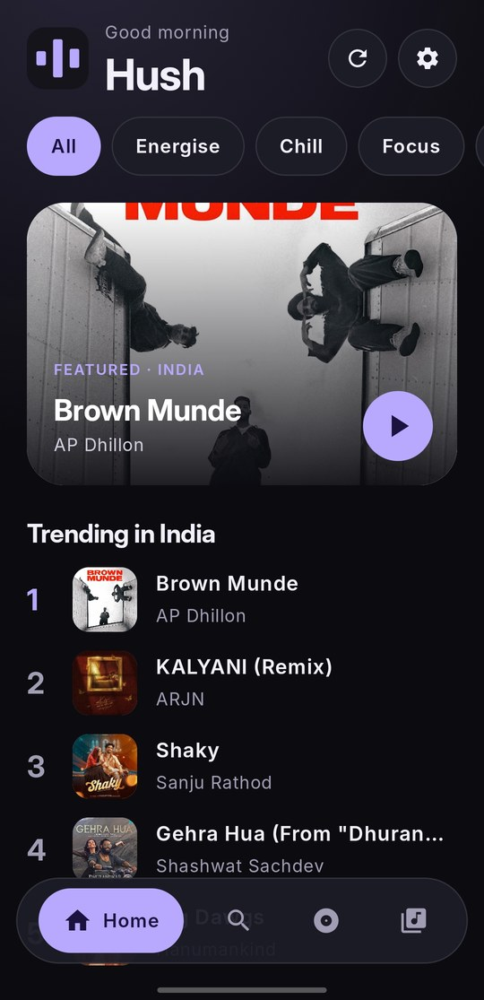
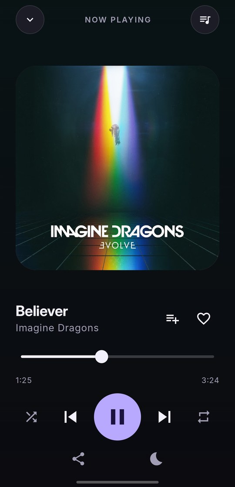
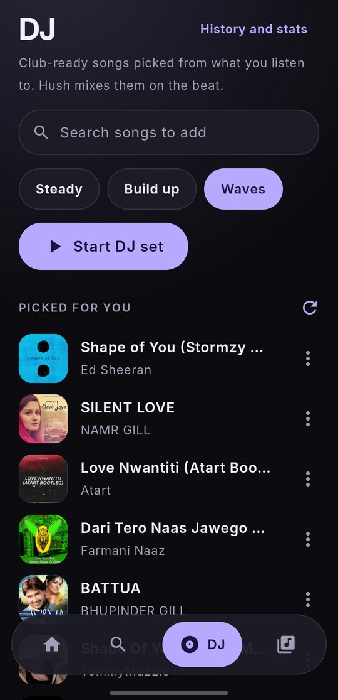
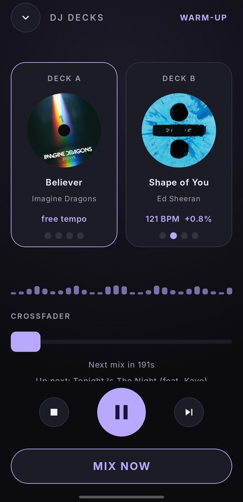

# Hush

[](https://github.com/mananmadani/HUSH-ANDROID/actions/workflows/build.yml)
[](https://github.com/mananmadani/HUSH-ANDROID/releases/latest)
[](https://github.com/mananmadani/HUSH-ANDROID/releases)
[](LICENSE)


**A quiet music player for Android.** Hush streams music from YouTube Music with no ads, no tracking
and no account. It does one job and leaves everything else out.

> **Like Hush? Give it a ⭐** at the top of this page. It's free, and it helps other people find the app.

<p align="center">
  
  
  
  
</p>

<p align="center"><sub>Home, the player, the DJ tab and the DJ decks. Cover art belongs to its respective owners.</sub></p>

## Features

- **Home that fits you:** rows for your country and language, "Because you liked ..." picks built
  from your liked songs, and a "Recently played" row. All of this is worked out on your phone.
- **Dusk design:** a dark, colourful interface with a floating navigation bar, mood chips on Home,
  and a player that takes its colours from the cover art. Pick your accent colour in Settings.
- **Search:** find any song on YouTube Music, with live suggestions (can be switched off),
  recent searches and mood tiles.
- **Recommendations from what you listen to, on your phone:** a "Made for you" row, a "Rediscover" row and a time-of-day
  row on Home, a Daily Mix and an endless queue that follow what you play through, replay or skip,
  and "Don't play this" for songs and artists you never want to hear. Nothing leaves the phone.
- **Full player:** queue, shuffle, repeat, seek, and an endless "up next" built from related songs.
- **Background playback:** notification and lock-screen controls (Media3).
- **Library:** liked songs and your own playlists as clean cards with their covers, stored on your
  device, plus backup and restore to a file you keep. A backup holds everything (library, taste, stats and
  settings) and is locked with your password using AES-256, so a new phone keeps your recommendations.
- **DJ mode:** a tab of its own with endless club-friendly songs picked from your taste, mixed on the beat with tempo matching, bass swaps, filter sweeps and echo outs. Search and queue songs, drag to reorder, and it keeps its own history and stats, separate from normal playback.
- **Daily Mix and listening stats:** a fresh mix each day and your top songs and artists, all worked out on your phone.
- **Search inside playlists** and an **update check** that notifies you of new versions (on by default, can be turned off).
- **Artists, albums and playlists:** search them, open their pages, play them or save them to your library.
- **Import playlists:** bring in a public YouTube or Spotify playlist from its link.
- **Light and dark themes** with seven accent colours.
- **Home-screen widgets:** a 4x2 "Now playing" widget with controls and a compact 2x2 one.
- **Your playlists on Home:** jump straight into Liked songs or any playlist.
- **Queue and sleep timer:** see what is up next, jump to or remove songs, and stop after 15-60
  minutes or at the end of the song. Share any song as a link.
- **Private by design:** no sign-in, no analytics, no ads, no servers of our own. See [PRIVACY.md](PRIVACY.md).

What Hush deliberately does not have: lyrics, social features, accounts, cloud sync, or telemetry of
any kind. Recommendations are built on your device from your own likes and history, and never leave it.

## Download

[](https://github.com/mananmadani/HUSH-ANDROID/releases/latest)

1. Tap the button above, then download the `.apk` file listed under **Assets**.
2. Open the file on your phone. If asked, allow installing from unknown sources.
3. Open Hush and allow notifications, so the playback controls can show.

**Prefer automatic updates?** Add Hush to [Obtainium](https://obtainium.imranr.dev/) with this link
(Obtainium installed): [Add Hush to Obtainium](obtainium://add/https://github.com/mananmadani/HUSH-ANDROID).
It watches the releases here and tells you when a new version is out.

Requires Android 8.0 (API 26) or newer. Releases are signed with a permanent key, so new versions
install over the old one and keep your liked songs and playlists.

## Build from source

You need JDK 17 and the Android SDK (API 34). The easiest route is Android Studio: open the
project and run the `app` configuration.

From the command line, with [Gradle](https://gradle.org/) 8.7 or newer installed:

```bash
gradle assembleDebug     # debug APK  -> app/build/outputs/apk/debug/
gradle assembleRelease   # release APK -> app/build/outputs/apk/release/
```

No Android SDK locally? Fork the repo and run the **CI** workflow from the Actions tab; the APK is
attached to the run as an artifact.

## How it works

```
UI (Jetpack Compose)  ->  HushVm  ->  YtMusic (NewPipeExtractor)   search, related, stream links
                              |
                              +->  PlayerController -> PlaybackService (Media3 / ExoPlayer)
                              +->  Repo -> Room (liked songs, playlists)
```

Queue items carry the YouTube watch URL. The real audio stream link is resolved right before each
track loads and cached for a few hours, so long queues never hold expired links.

| Path | Purpose |
| --- | --- |
| `app/src/main/java/app/hush/net` | OkHttp downloader and the YouTube Music wrapper |
| `app/src/main/java/app/hush/player` | Foreground playback service and its UI-side controller |
| `app/src/main/java/app/hush/data` | Room database and repository |
| `app/src/main/java/app/hush/ui` | Compose screens, components and theme |

## Disclaimer

Hush is an independent project. It is **not affiliated with, endorsed by, or sponsored by Google
LLC or YouTube**. "YouTube" and "YouTube Music" are trademarks of Google LLC.

Hush gets its data through [NewPipeExtractor](https://github.com/TeamNewPipe/NewPipeExtractor),
which uses YouTube's unofficial, undocumented endpoints. This may conflict with YouTube's Terms of
Service, and it can stop working at any time when YouTube changes things. When that happens, updating
the NewPipeExtractor version in `app/build.gradle.kts` is usually the fix. Use Hush at your own risk
and for personal use. Please support the artists you listen to.

## Help Hush grow

Hush is a one-person project, and a few small things make a real difference:

- **Star the repo** so others can find it.
- **Tell a friend** who is tired of ads in their music app.
- **Report bugs and ideas** in [Issues](https://github.com/mananmadani/HUSH-ANDROID/issues). Every
  message gets read.
- **Share a screenshot or short clip** of Hush, especially DJ mode, on your socials.

Website: <https://mananmadani.github.io/HUSH-ANDROID/>

## Contributing

Issues and pull requests are welcome. Please read [CONTRIBUTING.md](CONTRIBUTING.md) first, and keep
in mind the project's goal: **small and focused**. Features that add accounts, tracking, or
clutter will not be accepted.

## Security

Please report vulnerabilities privately. See [SECURITY.md](SECURITY.md).

## License

Hush is free software released under the [GNU General Public License v3.0](LICENSE), as required by
its use of NewPipeExtractor (GPLv3).

## Acknowledgements

- [NewPipeExtractor](https://github.com/TeamNewPipe/NewPipeExtractor) by the NewPipe team
- [Inter](https://rsms.me/inter/) typeface by Rasmus Andersson, bundled under the SIL Open Font License
- [AndroidX Media3](https://developer.android.com/media/media3), [Room](https://developer.android.com/training/data-storage/room),
  [Jetpack Compose](https://developer.android.com/compose), [OkHttp](https://square.github.io/okhttp/) and [Coil](https://coil-kt.github.io/coil/)
